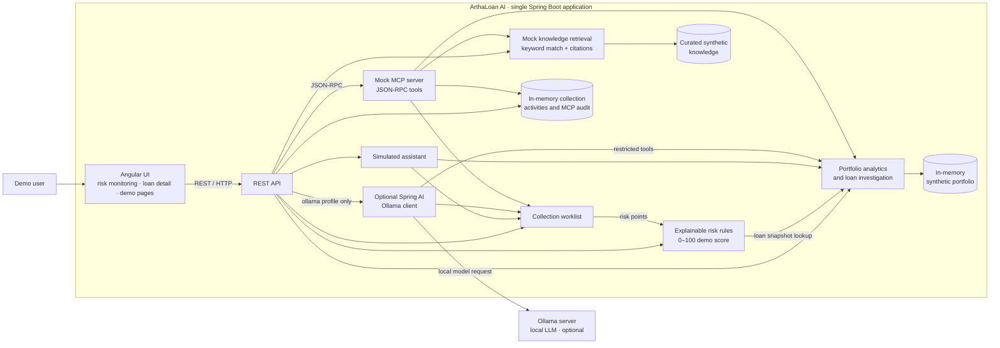

# ArthaLoan AI

[](https://openjdk.org/)
[](https://spring.io/projects/spring-boot)
[](https://angular.dev/)
[](https://modelcontextprotocol.io/)
[](#run-the-demo)

ArthaLoan AI is a local banking showcase for synthetic loan-portfolio
analytics, loan investigation, collection prioritization, and governed AI
integration patterns. It is designed to run quickly without Docker,
external banking services, or an AI model.

All records are deterministic synthetic demo data. The application is for
demonstration and decision support only: it does not make lending
decisions, contact borrowers, or initiate account-changing actions. Do
not add real customer or confidential banking data.

## Architecture at a glance



Risk monitoring and loan investigation read the same generated,
in-memory portfolio through the backend. The risk rules produce
explainable demo points from current DPD, recent unpaid installments, and
payment reversals; they do **not** estimate a validated future outcome
or probability. The collection worklist also uses this risk signal.

The simulated assistant, optional Spring AI + Ollama, local keyword RAG,
and mock MCP server are distinct backend capabilities. RAG returns
citations but does not call an LLM. MCP exposes allowlisted read-only
tools to its demo UI; it is **not connected as an MCP client to the
Ollama agent**. Ollama runs separately and is contacted only when the
`ollama` Spring profile is enabled. All data shown is synthetic.

## Run the demo

Requirements: Java 25 and Node.js 22.22.3+, 24.15.0+, or 26+ with npm.
The startup script uses an installed Maven if available; otherwise it
downloads Maven 3.9.9 into the user cache.

```sh
./demo.sh
```

Open [http://localhost:8080](http://localhost:8080). The script installs
the frontend's locked dependencies, builds Angular, packages the frontend
into the Spring Boot application, and starts a single executable JAR.
Stop it with `Ctrl+C`. Set `SERVER_PORT` to choose another port:

```sh
SERVER_PORT=8090 ./demo.sh
```

No database, Docker, Ollama installation, or API key is needed for the
default demo.

## What the demo includes

- **Portfolio dashboard** — filterable repayment metrics, delinquency
  distribution, PAR 1/7/30/90, and repayment trends.
- **Loan portfolio** — synthetic account search and investigation with
  installment schedules, payment allocations, reversals, DPD, and
  outstanding balances.
- **Risk monitoring** — deterministic, explainable 30-day demo scores.
  The portfolio screen summarizes risk bands, average score, and
  per-loan contributing factors, with links to loan investigation. The
  rules use current DPD, unpaid recent installments, and recent payment
  reversals. These points are illustrative risk signals—not a trained
  model, calibrated probability, or validated forecast of future
  delinquency.
- **Collections** — a versioned, ranked worklist with visible priority
  factors, plus simulated collection activity recording. No contact is
  sent and no action is taken automatically.
- **Analytics assistant** — a deterministic mock assistant that selects
  from allowlisted analytics and collection-worklist tools and displays
  its evidence and tool trace. It does not call an LLM.
- **Knowledge RAG** — local keyword retrieval from a small curated set of
  synthetic metric and policy notes. Answers include cited excerpts and
  return an explicit no-match response. This page does not use embeddings,
  a vector database, or an LLM.
- **MCP tools** — a mock MCP server interface for discovering and calling
  read-only tools over JSON-RPC. The page shows tool schemas, results, and
  recent audit events.
- **Spring AI + Ollama** — an optional page for using a local chat model
  with restricted tools over synthetic analytics and collection data.
  Disabled by default.

The default synthetic portfolio has 12 customers, 12 loans, and 144
installments. Its seed is `20261117`, and its as-of date is `2026-10-31`.
Override them with `ARTHALOAN_DEMO_SEED` and
`ARTHALOAN_DEMO_AS_OF_DATE` when launching the backend. Metric
definitions, calculation conventions, and data limitations are in
[`docs/data-dictionary.md`](docs/data-dictionary.md).

### What the risk score means

The risk screen makes the existing loan-level demo score visible across
the portfolio. It is calculated from **current snapshot evidence**:
DPD (up to 40 points), unpaid balances in the three most recent due
installments (up to 30 points), and a recent payment reversal (15 points
when present). Scores are grouped into LOW, MODERATE, and HIGH bands and
shown with the factors that contributed to each score. The “30-day”
label describes the demo's configured horizon; the current rules do not
estimate a statistically validated probability that a loan will become
delinquent in the next 30 days.

This is intentionally a mock prediction experience for demonstrating
explainability and risk-monitoring UI. A real predictive model would
require suitable historical repayment outcomes, leakage-safe features,
time-based evaluation, calibration, bias checks, and ongoing monitoring.
The synthetic fixture is not suitable for training or validating such a
model.

## Mock MCP server

The **MCP tools** page initializes the mock server, discovers its
allowlisted tools, and lets you call them with validated inputs. The
backend endpoint is `POST /api/demo/mcp`; the demo implements JSON-RPC
initialization and the `tools/list` and `tools/call` methods using protocol
version `2025-03-26`.

Available tools:

| Tool | Purpose |
|---|---|
| `get_portfolio_summary` | Return synthetic portfolio totals and PAR 30. |
| `get_loan_snapshot` | Look up one synthetic loan using an ID such as `LN-002`. |
| `get_collection_worklist` | Return a bounded number of ranked overdue accounts for review. |
| `search_approved_knowledge` | Search the curated demo knowledge and return cited sources. |

`GET /api/demo/mcp/audit` returns up to 50 recent in-memory tool-call
events. It records the tool name, outcome, input field names, and time;
input values are not stored. Events clear when the server restarts.

This is a protocol demonstration, not a production MCP deployment. It
has no authenticated MCP client, caller identity, or banking
authorization. **MCP standardizes tool communication; it does not itself
provide authentication or authorization.** Do not expose this demo
endpoint to untrusted users or connect it to real banking data.

For example, list the tools with curl while the app is running:

```sh
curl -s http://localhost:8080/api/demo/mcp \
  -H 'Content-Type: application/json' \
  -d '{"jsonrpc":"2.0","id":1,"method":"tools/list"}'
```

## Optional Spring AI + local Ollama

The Ollama page is separate from the simulated assistant and mock MCP
page. To enable it, install Ollama, start its local server, and download
the default model:

```sh
ollama pull llama3.2:3b
SPRING_PROFILES_ACTIVE=ollama ./demo.sh
```

The configured model is called only with the `ollama` Spring profile.
This optional page exposes synthetic portfolio analytics and collection
worklist tools; it does not expose account-changing operations. Set
`OLLAMA_MODEL` to use another downloaded model or `OLLAMA_BASE_URL` to
configure the Ollama server URL. The application does not download models
automatically. Use synthetic prompts only.

## Development

For separate frontend/backend development, use two terminals. With Maven
installed, start Spring Boot in the first:

```sh
mvn spring-boot:run
```

Then start Angular in the second:

```sh
npm --prefix frontend start
```

Open [http://localhost:4200](http://localhost:4200). The Angular
development-server proxy forwards `/api` requests to the backend.

Docker Compose is an optional alternative:

```sh
docker compose up --build
```

## API overview

| Endpoint | Description |
|---|---|
| `GET /api/health` | Application health. |
| `GET /api/demo/portfolio` | Full synthetic portfolio snapshot. |
| `GET /api/demo/analytics` | Portfolio metrics and trends, with optional filters. |
| `GET /api/demo/loans` and `GET /api/demo/loans/{loanId}` | Loan list and investigation details. |
| `GET /api/demo/loans/{loanId}/risk` | One loan's explainable, deterministic demo risk score and factors. |
| `GET /api/demo/risk-monitoring` | Portfolio-wide demo scores, band counts, average score, and contributing factors. |
| `GET /api/demo/collections/worklist` | Ranked synthetic collection worklist. |
| `POST /api/demo/assistant/ask` | Simulated analytics assistant. |
| `GET /api/demo/rag/knowledge` and `POST /api/demo/rag/ask` | Curated knowledge sources and mock RAG retrieval. |
| `POST /api/demo/mcp` | Mock MCP JSON-RPC initialization and tool requests. |
| `GET /api/demo/mcp/audit` | Bounded in-memory MCP tool-call audit. |
| `/api/demo/ollama/*` | Optional local Ollama assistant endpoints. |

Collection activity entries and MCP audit events are held in memory and
are cleared when the application restarts. Authentication, durable audit
storage, production banking integrations, and trained model predictions
are not implemented.
