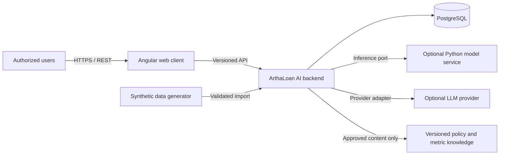
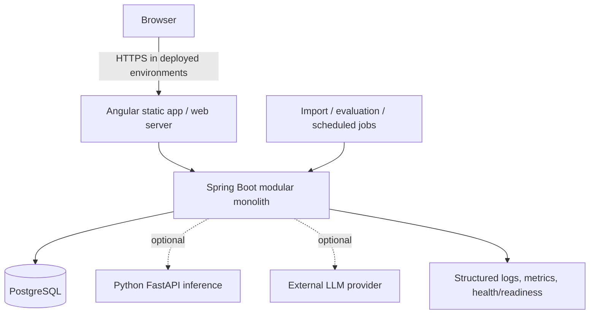

# ArthaLoan AI — Software Architecture

This document describes the **target architecture** for ArthaLoan AI using
the arc42 structure. It is an architecture baseline derived from
[`REQUIREMENT.md`](REQUIREMENT.md), not a claim that the described
components have already been implemented. Technology choices marked
provisional must be confirmed during implementation.

## 1. Introduction and Goals

ArthaLoan AI is a portfolio-grade banking technology showcase for
understanding repayment performance, identifying emerging delinquency
risk, supporting collection prioritization, and answering approved
portfolio questions with traceable evidence.

The initial system is a modular monolith. It uses synthetic data and is
for decision support only: it does not approve or reject credit, change
loan terms, contact borrowers, or initiate adverse collection actions.
Human users remain responsible for operational decisions.

### Quality goals

| Priority | Goal | Architectural implication |
|---|---|---|
| 1 | Trustworthy, reconcilable analytics | Calculate quantitative metrics in deterministic backend queries; document definitions and as-of semantics. |
| 2 | Secure, role-aware access | Authenticate and authorize every protected operation on the server, including AI tools and exports. |
| 3 | Explainable risk intelligence | Version predictions, features, model metadata, and explanations; present estimates with limitations. |
| 4 | Maintainable modularity | Keep domain ownership within modules and prohibit cycles and arbitrary cross-module persistence access. |
| 5 | Controlled, grounded AI | Constrain the assistant to approved tools and knowledge sources; validate outputs and retain provenance. |
| 6 | Repeatable demonstration | Generate reproducible synthetic datasets and provide documented local deployment and demo workflows. |

## 2. Architecture Constraints

- The initial backend is a **modular monolith** with explicit module
  boundaries; service extraction is a future option, not an initial
  requirement.
- Initial data is synthetic only. No real customer or confidential bank
  data may be included in the repository or public demo.
- Backend authorization is authoritative. UI visibility is not an access
  control.
- The AI assistant cannot have unrestricted database or system access.
  Numeric answers must come from authorized analytics interfaces.
- Model predictions and collection suggestions are advisory. Human
  review is required, and no autonomous adverse or borrower-contact
  action is allowed.
- Monetary values use fixed-precision decimal types and explicit
  currency. Timezone and business-date semantics must be documented.
- The initial demo uses USD, calendar-day DPD with no grace period, and
  the oldest unpaid installment as the DPD anchor. PAR thresholds are
  inclusive and balance-based; the agreed repayment-rate convention is
  documented in the metric semantics below.
- Preferred technology baseline: Angular; Java 25 and Spring Boot,
  subject to dependency compatibility; PostgreSQL; Python/FastAPI and
  scikit-learn with XGBoost or LightGBM as appropriate; REST/OpenAPI.
- The primary demo launch should not require Docker: build the Angular
  client into Spring Boot static resources and serve both from one
  executable JAR. Docker Compose remains an optional deployment path.
- Redis, Kafka, Kubernetes, and external banking integrations are not
  prerequisites for the first vertical slice.
- Provider, identity, and external integration specifics remain
  configurable behind adapters.

## 3. Context and Scope

### Business context

| Actor / system | Interaction with ArthaLoan AI |
|---|---|
| Risk Analyst | Reviews portfolio risk, predictions, explanations, and model performance. |
| Collection Officer | Reviews assigned work and records simulated collection outcomes. |
| Collection Manager | Reviews team worklists, prioritization factors, and outcomes. |
| Credit / Portfolio Manager | Reviews portfolio trends and asks approved analytics questions. |
| Auditor / Read-only User | Reviews permitted reports, predictions, and audit history. |
| System Administrator | Manages demo users, roles, and platform configuration. |
| Synthetic data generator / import | Supplies versioned customers, loans, schedules, payments, and collection records. |
| Optional model provider | Supplies prediction inference behind a controlled adapter; it does not own loan business rules. |
| Optional LLM provider | Generates language from approved retrieved content and authorized tool results. |

### System boundary

Inside the system are identity and access, loan and repayment records,
delinquency calculations, deterministic analytics, risk integration,
collection worklists, the AI assistant, reporting, audit, and platform
operations. External model/LLM providers and any future banking source
systems are outside the boundary and must be accessed through adapters.

Excluded from the initial release are production integrations, real
customer data, autonomous lending or collection decisions, real-time
streaming, and an unrestricted AI agent.

## 4. Solution Strategy

1. Build one deployable application backend with explicit business
   modules and REST APIs. Keep Angular as a separate web client.
2. Keep rules, orchestration, validation, authorization, and transaction
   boundaries in domain/application layers rather than controllers or
   UI components.
3. Use a shared PostgreSQL deployment initially, while keeping
   persistence mappings, migrations, and table ownership with the
   responsible module.
4. Compute portfolio metrics through deterministic queries or validated
   analytical services. Make metric definitions, filters, period, and
   data freshness visible in responses.
5. Treat model training as a reproducible offline workflow. Serve
   inference through a typed port so the implementation can use a local
   model or a separately deployed Python service without coupling the
   domain to a vendor or transport.
6. Route assistant requests only to an allowlisted set of application
   tools. Re-check the caller's permissions inside every tool, validate
   arguments, and use structured results as the source for numeric
   claims.
7. Record material user, prediction, collection, and AI operations in
   structured audit events with actor, timestamp, outcome, object
   reference, and correlation ID.
8. Use in-process events and scheduled/background jobs initially.
   Introduce a broker or separate services only when measurable scaling,
   deployment, or ownership needs justify the operational cost.
9. Keep AI functionality switchable independently from deterministic
   analytics and reporting.

## 5. Building Block View

### Level 1 — System

The backend is the system of record for application workflows and the
enforcement point for authorization. The model service and LLM provider
are optional integration boundaries; failure or disablement must not
prevent deterministic portfolio analytics.

### Level 2 — Backend modules

| Module | Responsibility and owned concepts | Exposes |
|---|---|---|
| Identity & Access | Authentication adapter, users, roles, permissions | Identity context and authorization decisions |
| Customer | Synthetic customer references and permitted segmentation fields | Authorized customer queries |
| Loan Management | Products, loan accounts, lifecycle status | Loan queries and lifecycle use cases |
| Repayment | Schedules, payment transactions, allocations, reversals, adjustments | Repayment queries and posting use cases |
| Delinquency | As-of DPD calculation, snapshots, DPD buckets | Delinquency queries and snapshot jobs |
| Analytics | Repayment rate, PAR, trends, roll rates, cure rates, filters | Deterministic metric query interface |
| Risk & ML | Feature definitions, eligibility, inference adapter, predictions, explanations, model metadata and feedback | Prediction and model-insight use cases |
| Collections | Worklists, versioned prioritization policy, activity and outcomes | Worklist and activity use cases |
| AI Assistant | Prompt orchestration, approved retrieval, tool registry, response validation, AI interaction metadata | Authorized assistant use case |
| Audit & Reporting | Audit events and authorized CSV report generation | Audit query and export interfaces |
| Platform & Observability | Configuration, correlation IDs, health, metrics, logging, background jobs | Shared technical capabilities |

Modules own their domain models and persistence mappings. A module may
not access another module's repositories or internal entities directly.
Cross-module calls use explicit application interfaces, well-defined
queries, or in-process events. Cyclic dependencies are prohibited.

### Level 3 — Key ports and adapters

| Port / contract | Adapter examples | Rule |
|---|---|---|
| `PredictionProvider` | Local inference; HTTP client for Python/FastAPI | Typed request/response, timeout, model version, explicit unavailable/error state |
| `LanguageModelProvider` | Provider-specific LLM client | Provider configuration remains outside domain modules; usage is bounded and observable |
| `KnowledgeSource` | Versioned local metric/product/policy documents | Retrieved material is untrusted data, never executable policy |
| `IdentityProvider` | Demo authentication; future enterprise identity provider | Application authorization remains server-side |
| Import source | Synthetic generator; future source-system adapter | Validate, deduplicate, quarantine invalid rows, report reconciliation counts |
| Persistence | PostgreSQL repositories and module-owned migrations | Parameterized queries/safe ORM; module ownership remains explicit |

## 6. Runtime View

### 6.1 Portfolio analytics request

1. A user selects a reporting period and filters in the web client.
2. The API authenticates the request and checks the user's permission and
   data scope.
3. The Analytics module validates filters and queries approved
   application interfaces / module-owned data views.
4. It returns metric values together with definitions, currency,
   reporting period, as-of/refresh time, applied filters, and
   unavailable-versus-zero status.
5. The client presents the values and provenance. The language model is
   not involved in calculating aggregates.

### 6.2 Risk prediction

1. An authorized user or scheduled job requests a prediction for an
   eligible loan as of a documented timestamp.
2. Risk & ML assembles only features available at that timestamp and
   checks data sufficiency and eligibility.
3. The `PredictionProvider` returns a score or calibrated probability,
   model/version metadata, and explanation data where supported.
4. Risk & ML validates and persists the prediction, horizon, timestamp,
   feature/model versions, and status; insufficient data yields an
   explicit ineligible/unavailable result, never a fabricated score.
5. The UI labels the result as an estimate and shows contributing
   factors and model limitations. A later job associates the actual
   outcome for evaluation.

### 6.3 Collection worklist and activity

1. The Collections module gathers overdue state, exposure, risk signals,
   and versioned policy rules through approved interfaces.
2. It creates a prioritized worklist with the factors and policy
   version used.
3. The authorized officer reviews an account and records a simulated
   activity, outcome, promise, or follow-up date.
4. The operation is validated, persisted, and audited. No borrower
   message or adverse action is executed.

### 6.4 Grounded AI question

1. The assistant authenticates the user and creates an interaction
   context carrying their permissions and correlation ID.
2. The AI Assistant retrieves only approved definitions and invokes
   allowlisted analytics or account tools. Tool arguments are
   schema-validated and permissions are rechecked by the tool.
3. Tools return structured results with metric definition, period,
   filters, and source references. The LLM may explain these results
   but cannot compute or invent portfolio values.
4. The response validator checks required provenance and unsupported or
   insufficient-data conditions before returning the answer.
5. Prompt/tool/response metadata and outcome are logged with sensitive
   values minimized or redacted. AI can be disabled while the normal
   analytics API remains available.

## 7. Deployment View

### Primary local demo target (no Docker)

The local demo requires Java 25 and a supported Node.js/npm version.
`demo.sh` installs locked frontend dependencies, builds Angular,
packages the generated static client into the Spring Boot executable
JAR, and starts the application. Maven is used if installed; otherwise
the script downloads a pinned Maven distribution and verifies its
SHA-512 checksum. The UI and API share one origin and port, avoiding a
separate frontend server or browser CORS configuration.

### Optional containerized target

Docker Compose can run the web client and backend as separate containers.
The model service, LLM provider, and PostgreSQL are optional until a
feature needs them. Kubernetes is an advanced future deployment target,
not a demo prerequisite.

Deployed environments must use TLS. Secrets are injected through
environment configuration or a secret manager and must not be stored in
source control. Health/readiness endpoints, documented restart behavior,
and bounded external-call timeouts are required. The exact topology,
resource sizing, and production availability targets are undecided.

## 8. Crosscutting Concepts

### Security and privacy

- Deny by default; apply least-privilege roles and resource-level
  authorization in the backend.
- Apply authorization to APIs, exports, account lookups, and every AI
  tool call. Do not rely on UI controls.
- Use synthetic data only in the public showcase; minimize sensitive
  values in prompts, logs, and audit payloads.
- Treat prompts, imported files, and retrieved text as untrusted input.
  Retrieval cannot override policy or access controls.
- Parameterize database access, validate inputs, bound pagination and
  external usage, and rate-limit external LLM calls.
- Provide an operational mechanism to disable AI and use deterministic
  analytics / rules instead.

### Data and metric semantics

- Use fixed-precision decimal amounts and explicit currency.
- Record timestamps with a documented timezone and business-date
  convention; calculations take an explicit as-of date.
- The initial demo currency is USD. Currency is explicit in monetary
  records and configurable for future locales. DPD is the number of calendar days
  from the oldest unpaid installment's due date to the as-of business
  date, with no grace period; a partial payment does not reset DPD while
  that installment remains unpaid.
- Repayment rate is amount-based: qualifying payment allocations posted
  during the selected reporting period, net of reversals, divided by
  scheduled amounts due during that period. Allocations must relate to
  installments due in the selected period. Payments posted before the
  period are excluded, including prepayments; partial payments count by
  allocated amount. Scheduled amounts include principal, interest, and
  applicable fees.
- PAR N is balance-based and uses `DPD >= N`: outstanding principal of
  loans meeting the threshold divided by total outstanding principal in
  the selected portfolio, measured as of the reporting date. The
  denominator includes the selected portfolio's outstanding principal,
  including delinquent loans.
- Preserve payment transaction history for reversals and adjustments.
- Make imports idempotent and report rejected/quarantined records with
  actionable reasons.
- Distinguish zero, missing, stale, and unavailable values.

### AI/ML governance

- Use chronological splits where feasible; prevent target leakage by
  restricting features to information available at prediction time.
- Version model artifacts, feature definitions, training data, code,
  parameters, evaluations, and model cards.
- Evaluate with precision, recall, PR-AUC, confusion matrix, and
  calibration; treat synthetic results as non-generalizable.
- Explain associations, not causes; identify unavailable or unstable
  explanations.
- Do not use protected/sensitive attributes as adverse-decision
  features. Predictions and suggested actions require human judgment.

### API, errors, and observability

- Publish versioned REST/OpenAPI contracts with consistent errors and
  input validation.
- Propagate correlation IDs and emit structured logs, operational
  metrics, and audit events for material operations.
- Redact secrets and minimize customer-level data in logs.
- External integrations have explicit timeouts and report failures;
  no success-shaped fallback may disguise unavailable predictions or
  provider failures.
- Background jobs should be idempotent and report duration,
  throughput, and failure counts; retries and failure handling must be
  explicit.

### User experience

All screens provide loading, empty, error, and no-permission states.
Key metric definitions, reporting periods, refresh time, currency,
synthetic-data labels, and AI provenance are accessible. The UI supports
keyboard navigation, readable contrast, and clear labels.

## 9. Architecture Decisions

| Decision | Status | Rationale / consequence |
|---|---|---|
| Modular monolith for the initial application backend | Accepted | Keeps local deployment simple while enforcing module boundaries for potential future extraction. |
| Single relational database initially, with module-owned persistence and migrations | Accepted | Simplifies operations without surrendering logical ownership; requires dependency discipline. |
| Deterministic backend analytics as the source of numeric truth | Accepted | Prevents generated text from becoming a source of financial figures and enables reconciliation tests. |
| AI tools call application interfaces, never unrestricted database access | Accepted | Makes authorization, validation, auditing, and tool scope enforceable. |
| Synthetic-only demo data | Accepted | Avoids exposure of real customer or bank data; model results do not establish production performance. |
| In-process events/jobs initially; defer Kafka and Kubernetes | Accepted | Avoids infrastructure overhead before scale or integration needs are demonstrated. |
| Python model inference behind a provider port | Proposed | Honors the ML technology baseline while insulating domain logic from deployment and provider details. Final placement (in-process/local versus separately deployed service) is implementation-dependent. |
| Java 25 / Spring Boot and Angular | Provisional | Preferred baseline; verify ecosystem and dependency compatibility and pin supported versions before implementation. |
| Currency, DPD policy, repayment-rate formula, and PAR convention for the initial demo | Accepted | Use USD; keep currency explicit and configurable for future locales; calendar-day DPD with no grace period anchored to the oldest unpaid installment; amount-based repayment rate using period-posted allocations net of reversals over amounts due in-period; PAR uses inclusive DPD thresholds and outstanding-principal balances. |
| Prediction label, risk thresholds, identity provider, LLM provider, retention periods | Open | Resolve and document in domain documentation or decision records before the relevant feature is considered complete. |

## 10. Quality Requirements

| Scenario | Stimulus | Expected response |
|---|---|---|
| Authorization | A user requests an account, report, or AI tool outside their permission scope | The backend denies access consistently and records security-relevant activity without exposing protected data. |
| Metric correctness | A user requests portfolio metrics for a defined period and filters | Values are deterministic, reproducible, reconcilable to source records, and returned with definitions and as-of metadata. |
| Data insufficiency | A prediction request lacks required history or features | Return an explicit insufficient-data/ineligible status without a fabricated score. |
| Model provider failure | Inference times out or is unavailable | Surface a clear unavailable/error state; deterministic analytics remain usable and no misleading success response is emitted. |
| AI injection attempt | Retrieved text or user content requests policy override or unauthorized data | Treat it as untrusted data; tools remain allowlisted and independently authorized. |
| AI disablement | An operator disables AI capability | Assistant calls fail clearly or are unavailable, while deterministic analytics and reporting continue. |
| Import replay | The same synthetic source batch is submitted again | Stable identifiers/idempotency prevent duplicate business records and reconciliation output remains inspectable. |
| Dashboard load | Representative demo workload exercises common dashboard and read APIs | Target p95 below 2 seconds, excluding external LLM latency; validate against a documented workload before claiming achievement. |
| Background processing | Analytics or prediction batch runs | Report duration, throughput, and failures; retries do not duplicate material effects. |

## 11. Risks and Technical Debt

| Risk | Impact | Mitigation / follow-up |
|---|---|---|
| Synthetic data may create unrealistic patterns | Model and analytics results may not generalize | Document generator assumptions and limitations; do not claim real-world performance. |
| Financial metric conventions are unresolved | Different screens or reports could disagree | Resolve metric definitions centrally and cover them with reconciliation tests before analytics is complete. |
| Technology compatibility, particularly Java 25 ecosystem support | Build or dependency instability | Verify compatible framework versions and pin versions before implementing the backend. |
| External model/LLM availability, latency, or cost | User-facing feature failures or unpredictable cost | Keep integrations optional, use timeouts/rate limits/usage bounds, observe failures, and retain deterministic fallback capability. |
| Module boundaries erode in a shared codebase/database | Tight coupling obstructs testing and future extraction | Enforce ownership and interfaces; prohibit cross-module repository access and dependency cycles. |
| Audit/AI retention requirements are undecided | Privacy exposure or insufficient traceability | Define retention, deletion, and redaction policy before production-like use. |
| Demo authentication is not enterprise authentication | Inadequate for real institution deployment | Keep an identity adapter and require institution-specific security review before real-data deployment. |
| Scope could expand into autonomous lending or collection | Harmful or unauthorized outcomes | Preserve explicit prohibited-use constraints and require human review for recommendations. |

## 12. Glossary

| Term | Definition |
|---|---|
| DPD | Days past due, calculated from an applicable unpaid due date to a documented as-of business date under configured allocation and grace-period rules. |
| PAR N | Portfolio at Risk at threshold N; the specified outstanding principal for loans meeting the documented DPD threshold divided by the defined portfolio balance. |
| Roll rate | Share of accounts or balance that moves between delinquency buckets over defined observation dates. |
| Cure rate | Share of delinquent accounts or balance returning to the defined current state during an observation period. |
| Prediction horizon | Future period in which the defined delinquency outcome is predicted; initially 30 days per requirements. |
| As-of date | The business date at which a snapshot, DPD value, feature set, or metric is evaluated. |
| Synthetic data | Generated demonstration data that does not contain real customer or confidential banking records. |
| RAG | Retrieval-augmented generation: providing approved retrieved reference content to an LLM as context, while treating retrieved content as untrusted data. |
| Modular monolith | One deployable application organized into modules with explicit boundaries and controlled interfaces. |
